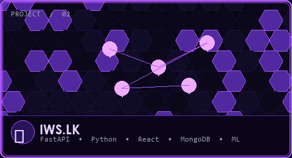
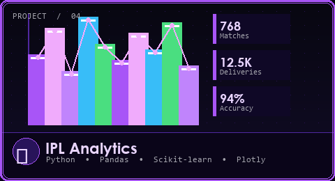

<!-- ═══════════════════════════════════════════════════════════════════ -->
<!-- HERO BANNER: ELITE SOFTWARE ENGINEERING SUITE                       -->
<!-- ═══════════════════════════════════════════════════════════════════ -->

  

<h2><b>SATHURJAN VIJITHAKUMARASENA</b></h2>

  <b>Software Engineering Undergraduate</b> &nbsp;•&nbsp; 
  <b>University of Moratuwa | Sri Lanka</b>

<!-- Specialization Badges -->

  &nbsp;
  &nbsp;
  &nbsp;
  

<!-- Professional Navigation Links -->

  &nbsp;
  &nbsp;
  &nbsp;
  

---

### ✦ About Me

I am a 3rd-year **Software Engineering undergraduate** at the **University of Moratuwa, Sri Lanka**, focused on solid software architecture fundamentals, resilient backend engineering, and scalable full-stack application development.

My technical approach centers on writing clean, modular code and designing robust distributed workflows:
- **Software Architecture:** Applying object-oriented principles, modular monoliths, layered service boundaries, and asynchronous event flows.
- **Backend & API Engineering:** Developing secure RESTful APIs, implementing stateless JWT/RBAC security, and optimizing database access patterns.
- **Data Modeling & Persistence:** Designing relational and document data schemas across PostgreSQL, MySQL, and MongoDB.
- **Applied Intelligence:** Integrating NLP and predictive machine learning models into practical software pipelines to solve real-world problems.
- **Continuous Technical Growth:** Rigorously expanding knowledge across systems engineering, cloud deployment, and high-performance computing.

---

### 🛠️ Technical Expertise

#### 💻 Programming Languages

  

<b>Core Stack:</b> Java &bull; Python &bull; C &bull; C++ &bull; JavaScript &bull; TypeScript

  

#### 🌐 Frontend Development

  

<b>Client Engineering:</b> React.js &bull; Next.js &bull; Tailwind CSS &bull; HTML5 &bull; CSS3

  

#### ⚙️ Backend Engineering & APIs

  

<b>Server Services:</b> Spring Boot &bull; Node.js &bull; FastAPI &bull; Express.js &bull; REST APIs &bull; WebSocket Protocols

  

#### 🗄️ Database Systems

  

<b>Persistence:</b> MongoDB Atlas &bull; MySQL &bull; PostgreSQL

  

#### 🧠 AI & Data Engineering

  

<b>Data Science & ML:</b> Python &bull; Pandas &bull; NumPy &bull; Scikit-learn &bull; NLP Preprocessing & Dependency Mapping

  

#### 🧰 Tools & Developer Environment

  

<b>DevOps & Tooling:</b> Git &bull; GitHub &bull; Docker &bull; Postman &bull; Visual Studio Code &bull; IntelliJ IDEA

---

### 📁 Featured Engineering Projects

<table border="0" cellspacing="12" cellpadding="10" width="100%">
<tr>
<td width="50%" valign="top" style="background-color: #0d0a1e; border-radius: 8px; border: 1px solid #7c3aed;">
  

    
      
    <h4>🧠 ReqTrace AI — Requirements Traceability Engine</h4>
    

      An intelligent natural language processing pipeline for software requirement traceability and dependency mapping. Identifies potential scope drift, parses functional requirements, and flags conflicting architectural specifications before implementation phases.
    

    

      
      
      
      
    

    

      <a href="https://github.com/Sathurjanv23" target="_blank"><b>View Repository ↗</b></a>
    

  

</td>

<td width="50%" valign="top" style="background-color: #0d0a1e; border-radius: 8px; border: 1px solid #7c3aed;">
  

    
      
    <h4>🌐 IWS.LK — Intelligent Logistics & Waste Management</h4>
    

      A geospatial logistics dispatch and waste management optimization platform. Features spatial zone routing, schedule coordination, dynamic fleet dispatch algorithms, and automated client pickup notifications.
    

    

      
      
      
      
      
    

    

      <a href="https://github.com/Sathurjanv23" target="_blank"><b>View Repository ↗</b></a>
    

  

</td>
</tr>

<tr>
<td width="50%" valign="top" style="background-color: #0d0a1e; border-radius: 8px; border: 1px solid #7c3aed;">
  

    
      
    <h4>🔄 CRMS — Change Request & Lifecycle Management</h4>
    

      Full-lifecycle enterprise change management platform engineered for structured engineering workflows. Implements multi-tier role-based access control (Client, Company, Admin), Kanban sprint pipelines, PRD management, and immutable audit logs.
    

    

      
      
      
      
      
    

    

      <a href="https://github.com/Sathurjanv23" target="_blank"><b>View Repository ↗</b></a>
    

  

</td>

<td width="50%" valign="top" style="background-color: #0d0a1e; border-radius: 8px; border: 1px solid #7c3aed;">
  

    
      
    <h4>📊 IPL Match Telemetry & Prediction Engine</h4>
    

      Comprehensive cricket tournament telemetry analytics engine and outcome prediction platform. Features interactive player performance visualizations, head-to-head match simulations, and statistical probability modeling across historical delivery data.
    

    

      
      
      
      
      
    

    

      <a href="https://github.com/Sathurjanv23" target="_blank"><b>View Repository ↗</b></a>
    

  

</td>
</tr>
</table>

---

### 📊 GitHub Analytics

&nbsp;

  

  

---

### 🌐 Connect With Me

Always open to software engineering discussions, backend architecture reviews, and innovative technical projects.

&nbsp;
&nbsp;
&nbsp;

 

<!-- ═══════════════════════════════════════════════════════════════════ -->
<!-- FOOTER ANIMATION                                                    -->
<!-- ═══════════════════════════════════════════════════════════════════ -->

  
    
  <i>"An engineering-minded developer who builds structured, scalable and practical software solutions."</i>

