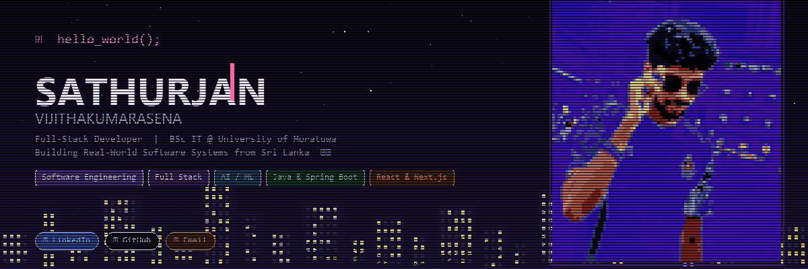

<!-- 🎮 Animated Pixel Art Banner -->

  

<!-- Navigation Pills -->
&nbsp;
&nbsp;
&nbsp;

  

<!-- Meta Info Tags -->
&nbsp;
&nbsp;
&nbsp;

---

## ✦ About Me

I'm **Sathurjan Vijithakumarasena**, a Software Engineer and IT undergraduate at the **University of Moratuwa**. I turn complex engineering challenges into elegant, production-ready software systems.

My engineering focus:
- 🏗️ **Enterprise Backend Systems** — ASP.NET Core (.NET 10), Spring Boot 3, FastAPI
- 🌐 **Full-Stack Platforms** — Next.js 14, React, TypeScript, Tailwind CSS
- 🤖 **AI-Augmented Systems** — ML Pipelines, NLP Traceability, Predictive Analytics
- 🗄️ **Data Architecture** — PostgreSQL, MongoDB Atlas, Redis, MySQL
- ☁️ **Cloud DevOps** — Docker, GitHub Actions CI/CD, AWS S3

> *"Build real systems. Ship real software. Learn every day."*

---

## 🔧 Tech Stack

### 🖥️ Languages & Runtimes

  
  
  
  
  
  
  

### ⚙️ Backend & Architecture

  
  
  
  
  
  
  

### 🌐 Frontend

  
  
  
  
  
  

### 🗄️ Databases & Cloud

  
  
  
  
  
  

### ☁️ DevOps & Tooling

  
  
  
  
  
  
  

---

## 🚀 Featured Projects

| 🏢 MaintenX | 🏥 MedAssist AI X |
|:---:|:---:|
| **Enterprise Multi-Tenant Facility Maintenance SaaS** | **High-Availability Healthcare Telemetry Platform** |
| Multi-tenant CQRS architecture, automated work-order dispatching, SLA enforcement | Bi-directional WebSocket clinical telemetry, Redis caching, AWS S3 medical records |
| `C#` `.NET 10` `PostgreSQL` `EF Core` `Next.js` `Docker` | `Spring Boot 3` `Next.js` `Redis` `WebSocket` `AWS S3` `Docker` |

| 🔄 CRMS | 📊 EduSmart AI |
|:---:|:---:|
| **Enterprise Change Request & Lifecycle Management** | **Student Performance & Risk-Prediction Analytics** |
| Stateful RBAC workflow engine, Kanban boards, immutable audit logging | ML risk prediction pipeline, dual-backend FastAPI + Spring Boot, GitHub Actions CI/CD |
| `Spring Boot` `Next.js` `TypeScript` `MongoDB` `JWT` | `FastAPI` `Spring Boot` `MongoDB` `Python` `Docker` |

---

## 📊 GitHub Analytics

&nbsp;

  

  

  

---

## 🏆 Honors & Certifications

| Achievement | Organization | Year |
|:---|:---|:---|
| 🥇 CryptX 2.0 — Top 20 Performer | University of Sri Jayewardenepura | 2026 |
| 🚀 CodeRally 7.0 — Finalist | Competitive Programming | 2026 |
| ⚡ JPura Xtreme 3.0 — Finalist | Algorithmic Hackathon | 2026 |
| 💡 Innovate with Ballerina | WSO2 | 2026 |
| 📮 API Fundamentals Student Expert | Postman | 2025 |
| 💻 Go (Intermediate) & Java (Basic) | HackerRank | 2025 |
| 📊 Intermediate SQL | DataCamp | 2025 |
| 🎓 Front-End Web Development | University of Moratuwa | 2025 |

---

## 🤝 Let's Connect & Build

&nbsp;
&nbsp;

  

