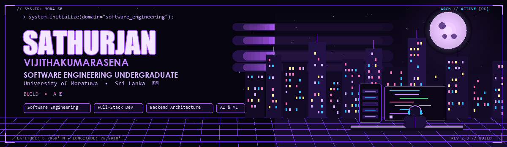
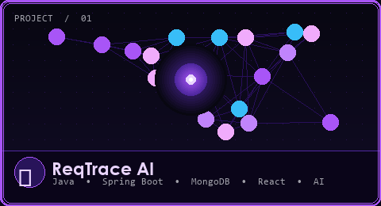
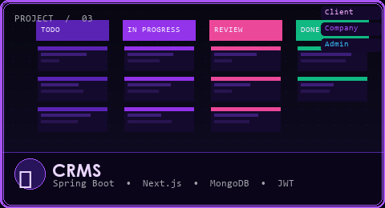
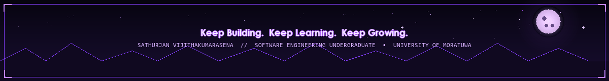

<!-- 🌌 HERO BANNER: PURPLE PIXEL UNIVERSE -->

  

<!-- Identity & Academic Status -->
<h3><b>SATHURJAN VIJITHAKUMARASENA</b></h3>

  <b>Software Engineering Undergraduate</b> &nbsp;•&nbsp; 
  <b>University of Moratuwa, Sri Lanka</b>

<!-- Domain Focus Badges -->

  &nbsp;
  &nbsp;
  &nbsp;
  

<!-- Navigation Action Pills -->

  &nbsp;
  &nbsp;
  &nbsp;
  &nbsp;
  

---

## ✦ About Me

I am a 3rd-year **Software Engineering undergraduate** at the **University of Moratuwa, Sri Lanka**, driven by a passion for architecting resilient backend systems and practical full-stack applications. I enjoy translating complex technical challenges into clean, structured, and performant code. Dedicated to continuous learning, I actively explore distributed workflows, modern software architecture, and applied artificial intelligence to build systems that deliver real-world value.

---

## 🛠️ Tech Stack

### 💻 Programming Languages

  

<b>Core Languages:</b> Java &bull; Python &bull; C &bull; C++ &bull; JavaScript &bull; TypeScript

  

### 🌐 Frontend Development

  

<b>Client-Side Stack:</b> React.js &bull; Next.js &bull; Tailwind CSS &bull; HTML5 &bull; CSS3 &bull; Vite

  

### ⚙️ Backend & Architecture

  

<b>Server-Side Engineering:</b> Java Spring Boot &bull; Node.js &bull; FastAPI &bull; RESTful APIs &bull; WebSockets

  

### 🗄️ Databases & Storage

  

<b>Data Persistence:</b> MongoDB Atlas &bull; MySQL &bull; PostgreSQL

  

### 🧠 AI & Machine Learning

  

<b>Intelligent Systems:</b> Python &bull; Pandas &bull; NumPy &bull; Scikit-Learn &bull; NLP Pipeline Processing

  

### 🧰 Tools & Development Environment

  

<b>Tooling & DevOps:</b> Git &bull; GitHub &bull; VS Code &bull; IntelliJ IDEA &bull; Docker &bull; Postman

---

## 📁 Featured Projects

<table border="0" cellspacing="12" cellpadding="8" width="100%">
<tr>
<td width="50%" valign="top" style="background-color: #110D1C; border-radius: 10px; border: 1px solid #7c3aed;">
  

    
      
    <b>🧠 ReqTrace AI — Requirements Traceability Engine</b> 
    NLP-driven software requirement traceability and dependency mapping engine to prevent scope creep, trace lifecycle changes, and detect architectural conflicts.
      
    
    
    
    
      
    <a href="https://github.com/Sathurjanv23"><b>Explore Repository ↗</b></a>
  

</td>

<td width="50%" valign="top" style="background-color: #110D1C; border-radius: 10px; border: 1px solid #7c3aed;">
  

    
      
    <b>🌐 IWS.LK — Intelligent Logistics & Waste Management</b> 
    Geospatial logistics coordination and waste management platform featuring route optimization, schedule tracking, and automated client alerts.
      
    
    
    
    
      
    <a href="https://github.com/Sathurjanv23"><b>Explore Repository ↗</b></a>
  

</td>
</tr>

<tr>
<td width="50%" valign="top" style="background-color: #110D1C; border-radius: 10px; border: 1px solid #7c3aed;">
  

    
      
    <b>🔄 CRMS — Change Request & Lifecycle Management</b> 
    Enterprise change management platform equipped with stateful RBAC workflow engine, real-time Kanban pipeline boards, and immutable audit logging.
      
    
    
    
    
      
    <a href="https://github.com/Sathurjanv23"><b>Explore Repository ↗</b></a>
  

</td>

<td width="50%" valign="top" style="background-color: #110D1C; border-radius: 10px; border: 1px solid #7c3aed;">
  

    
      
    <b>📊 IPL Match Telemetry & Prediction Engine</b> 
    Cricket tournament analytics engine and match simulation platform featuring player telemetry analysis and statistical win probability modeling.
      
    
    
    
    
      
    <a href="https://github.com/Sathurjanv23"><b>Explore Repository ↗</b></a>
  

</td>
</tr>
</table>

---

## 📊 GitHub Analytics

&nbsp;

  

  

---

## 🌐 Connect With Me

Always open to discussing software engineering projects, backend architecture, and technical collaborations.

&nbsp;
&nbsp;
&nbsp;

 

<!-- 🌌 FOOTER ANIMATION: PURPLE PIXEL UNIVERSE -->

  
    
  <i>"Keep Building. Keep Learning. Keep Growing."</i>

